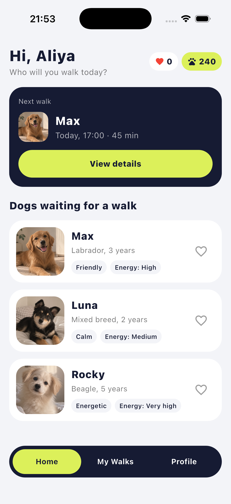
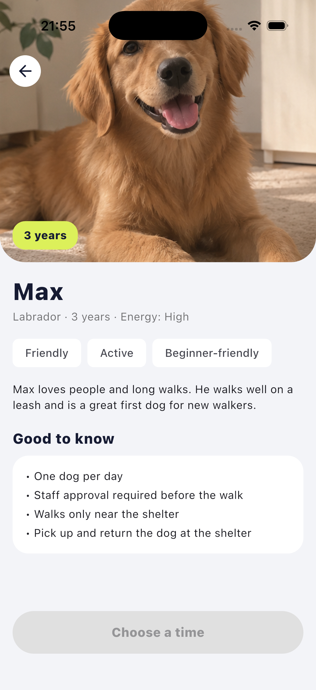
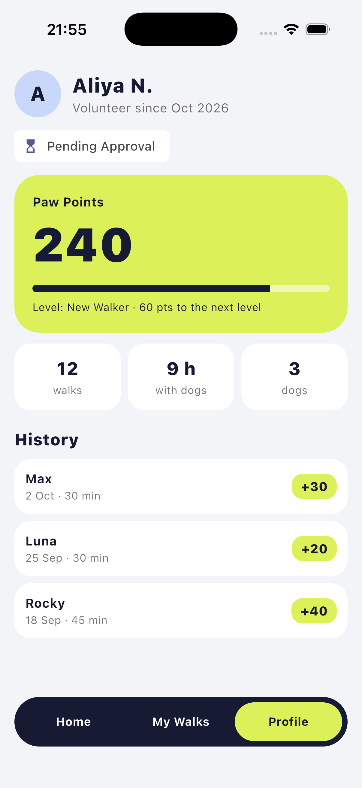

# 🐾 PawTime

A mobile app (Flutter) that connects an animal shelter with people who want to
spend time with shelter dogs by taking them on walks, without adopting.

## Problem
Shelter dogs need regular exercise, attention and social contact. Many people
want to help animals but cannot adopt a pet permanently. PawTime connects them:
users browse dogs, choose a time slot and book a walk. At the start the app
works with one shelter, without delivery: the dog is picked up and returned
at the shelter.

## Target user
People who love dogs but cannot adopt (students, people in rented flats,
volunteers) and want a safe, organised way to walk shelter dogs.

## Features (Milestone 1)
- Home screen with greeting, "Next walk" card and dog cards (photo, name, breed, age, tags)
- Favorite button ❤️ with live counter
- Dog details screen: photo with `Stack` overlay (age badge), tags, walk rules
- Time slot selection and "Book a Walk" button with booked state
- Profile screen: Paw Points, level, stats and walk history (demo data)
- Custom bottom navigation

## Milestone 2 — BLoC architecture (LW12)
All shared state moved from `setState` / `Provider` to `flutter_bloc`.
`MultiBlocProvider` sits above `MaterialApp`, so the volunteer part and the
staff part of the app work with the same data.

### Full walk flow
```
Volunteer books a dog ─► walks ─► sends geotagged photo (LW13)
        │                                   │
   WalksBloc: booked                  WalksBloc: reported
                                            │
              Shelter staff reviews photo + distance to shelter
                     │                                │
           WalksBloc: confirmed                WalksBloc: rejected
                     │                         (volunteer sends a new photo)
       PointsCubit: +30 Paw Points
                     │
   Rewards shop ─► CartBloc ─► Redeem ─► PointsCubit spends points
```

| BLoC / Cubit | What it holds | Used in |
|---|---|---|
| `AuthCubit` | `Initial → Loading → Success(role) / Error`; roles **volunteer** and **staff** | Login (`BlocConsumer`: listener = SnackBar + navigation by role) |
| `WalksBloc` | bookings with status; events `BookWalk`, `CancelWalk`, `ReportWalk`, `ConfirmWalk`, `RejectWalk` | Feed, Dog details, My Walks, Staff screen |
| `PointsCubit` | Paw Points history, balance, level | Profile, Feed, Rewards, Cart |
| `CartBloc` | rewards cart; events `ToggleReward`, `RemoveReward`, `ClearCart` | Rewards shop, Product detail, Cart |
| `FavoritesCubit` | `Set<String>` of favorite dogs | Feed, Favorites |
| `DiaryCubit` | geotagged walk photos | My Walks, Staff screen, Profile |

**Business rules live in the BLoCs, not in widgets:**
- One dog per day; each dog can be booked only once
- A walk that already has a photo report cannot be cancelled
- Staff can confirm or reject **only** a reported walk
- Paw Points are given **only** for a walk confirmed by staff, and only once
  (`BlocListener<WalksBloc>` in `main.dart` → `PointsCubit.awardWalk`)
- You cannot redeem rewards for more points than you have

**Rewards shop:** shelter rewards (pin, bandana, treats, coffee voucher…) plus
the partner store loaded from the REST API (fakestoreapi.com, with loading,
error and retry states).

**Test accounts** (password `123456`):
- Volunteer: `aliya@narxoz.kz`
- Shelter staff: `staff@pawtime.kz`

How to demo: log in as the volunteer → book a dog → My Walks → take a photo →
save → log out → log in as staff → Confirm → log in as the volunteer again →
+30 Paw Points in Profile → spend them in the Rewards shop.

## Milestone 3 — Camera & GPS (LW13): "My Walks" photo journal
After a walk the volunteer takes a photo with the dog. The photo is geotagged,
so shelter staff can see the walk happened near the shelter.

- **Permissions:** `AndroidManifest.xml` (CAMERA, ACCESS_FINE/COARSE_LOCATION,
  READ_MEDIA_IMAGES) and `Info.plist` (NSCameraUsageDescription,
  NSPhotoLibraryUsageDescription, NSLocationWhenInUseUsageDescription)
- **Camera + Gallery** with `image_picker` (`imageQuality: 80`, `maxWidth: 1080`),
  preview with `Image.file()` inside `ClipRRect`, placeholder icon when empty
- **GPS** with `geolocator`: `checkPermission` / `requestPermission`, spinner while
  locating, latitude, longitude, altitude, accuracy (± m), timestamp.
  Location is fetched automatically after a photo is taken
- **GPS off →** dialog with `Geolocator.openLocationSettings()`
- **Denied / "Don't ask again" →** no crash: SnackBar or dialog with "Open settings"
- **Walk zone check:** distance to the shelter (`Geolocator.distanceBetween`),
  green if within 1 km (rule "new walkers walk only near the shelter")
- **Diary feed:** caption + Save → list with thumbnail, caption, coordinates,
  time, distance. Saving a photo marks today's walk as *reported*
  (staff confirms it on the Staff screen → Paw Points)

### Defense answers
**Why is `NSCameraUsageDescription` mandatory on iOS?**
iOS shows this text in the system permission dialog, so the user knows why the
app wants the camera. If the key is missing, iOS terminates the app the moment
it tries to access the camera, and App Store review rejects the build.

**What happens when the user chooses "Don't ask again" on Android?**
The permission becomes *permanently denied*: `request()` returns at once
without showing a dialog (`PermissionStatus.permanentlyDenied` /
`LocationPermission.deniedForever`). The app cannot ask again. It must explain
why the permission is needed and send the user to the app settings
(`openAppSettings()`), where only the user can turn it back on.

## Planned (next milestones)
- Approve new volunteer accounts
- Database and REST API, save the diary to local storage
- Search and filters

## Screenshots
| Home | Dog Details | Profile |
|------|-------------|---------|
|  |  |  |

## Project structure
```
lib/
├── blocs/       # AuthCubit, WalksBloc, PointsCubit, CartBloc, FavoritesCubit, DiaryCubit
├── utils/       # Formatters (date, coordinates, distance)
├── models/      # Dog, Shelter, Product, Reward, DiaryEntry
├── screens/     # Login, Register, Main, Home, Dog Details, My Walks, Staff,
│                # Favorites, Profile, Rewards, Product detail, Cart
├── services/    # ProductService (REST), LocationService (GPS), MediaService (camera)
├── theme/       # App colors
├── widgets/     # DogCard, DogGridCard, DogImage, ProductImage, PawBottomNav, ZoneChip
└── main.dart
assets/images/   # Dog photos
```

## Run
```
flutter pub get
flutter run
```

## Author
Dina Kuralbay
